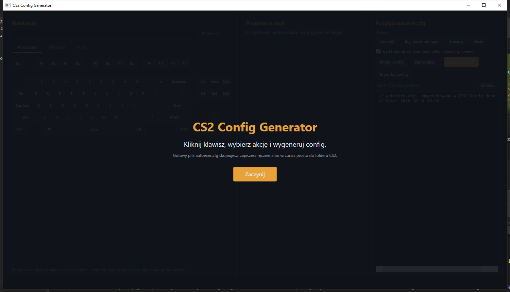
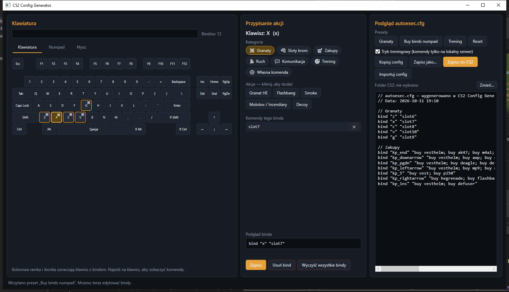
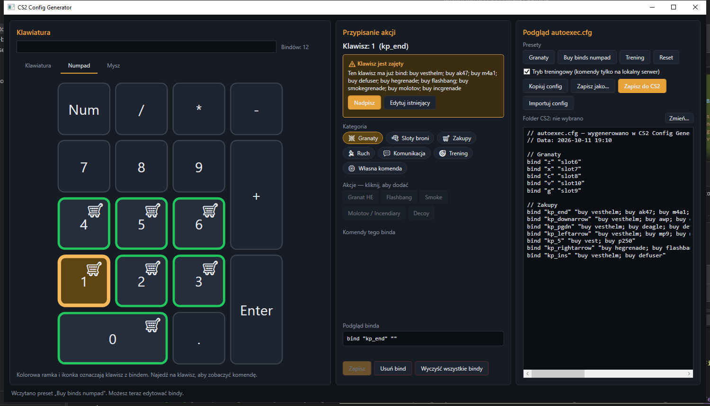
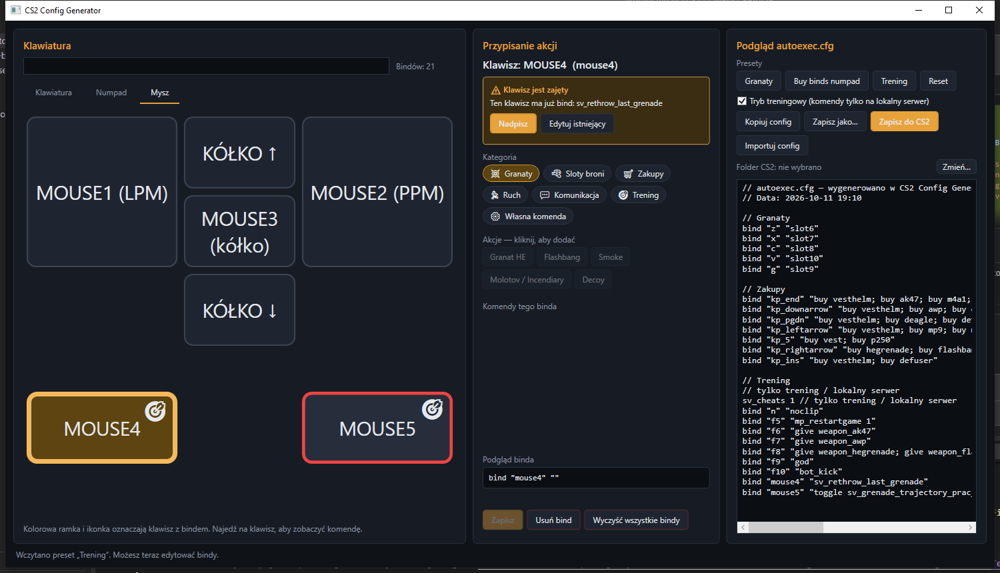

# CS2 Config Generator

🇵🇱 [Wersja polska](README.md)

A Windows desktop app (WPF, .NET 8, MVVM) that generates an `autoexec.cfg` for Counter-Strike 2.
Click a key on the visual keyboard, pick an action (grenade, buy, movement, custom command…) and the app
builds a ready-to-use config that you can copy, save anywhere, or write straight into your CS2 folder.

> The application UI is in Polish.

## Screenshots

| Welcome screen | Editing a bind (grenades preset) |
|---|---|
|  |  |

| Numpad buy binds | Training preset on the mouse tab |
|---|---|
|  |  |

## Requirements

- Windows 10/11
- [.NET 8 SDK](https://dotnet.microsoft.com/download/dotnet/8.0) to build, or the .NET 8 Desktop Runtime to run

## Build and run

```powershell
dotnet build CS2ConfigGenerator.slnx
dotnet run --project src/CS2ConfigGenerator
```

Tests (including the full scenario: flash on `x`, smoke on `c`, HE on `z`, molotov on `v`, buy bind on `kp_end`):

```powershell
dotnet test tests/CS2ConfigGenerator.Tests
```

Distributable build:

```powershell
dotnet publish src/CS2ConfigGenerator -c Release -r win-x64 --self-contained false -o publish
```

## Usage

1. **Click a key** on the keyboard (tabs: Keyboard, Numpad, Mouse).
2. **Pick a category and an action** — clicking an action adds its command to the bind. Multiple commands are joined with semicolons.
   The "Własna komenda" (custom command) category lets you type any console command.
3. Click **Zapisz** (Save). The key gets a colored border and a category icon; the tooltip shows the command.
4. The live config is shown on the right. Buttons:
   - **Kopiuj config** — copy to clipboard,
   - **Zapisz jako…** — save to any location (`.cfg`),
   - **Zapisz do CS2** — write to `game\csgo\cfg` (the folder is auto-detected, or you pick it manually; the choice is remembered),
   - **Importuj config** — loads `bind "key" "command"` lines from an existing file; everything else goes to the "Nie rozpoznane komendy" (unrecognized commands) section and is preserved on save.
5. If a key already has a bind, the editor shows a warning with **Nadpisz** (Overwrite) / **Edytuj istniejący** (Edit existing).
6. **Presets**: Granaty (grenades), Buy binds numpad, Trening (training), Reset. Presets add/overwrite binds on their keys (Reset clears everything); you can edit everything afterwards.
7. The search box above the keyboard highlights keys whose key name or command matches.

### Training mode

Commands that only work on a local server / with `sv_cheats` (`noclip`, `god`, `give`, `sv_*`, `mp_*`, `bot_*`…)
are **omitted** from the generated file by default (they remain as commented-out lines). Tick
"Tryb treningowy" to include them — they get a `// tylko trening / lokalny serwer` ("training only / local server")
comment and an `sv_cheats 1` line. The "Trening" preset enables this mode automatically.

### Backups

Before an existing file is overwritten, a backup is created, e.g. `autoexec_backup_2026-10-11.cfg`
(a time suffix is added on name collision). Files are written as UTF-8 without BOM.

## Settings and data

- Settings: `%AppData%\CS2ConfigGenerator\settings.json` (CS2 path, training mode, last folder).
- Data: `src/CS2ConfigGenerator/Data/` — `keys.json` (keyboard layout), `actions.json` (actions), `presets.json` (presets).
  You can add your own actions and presets without touching the code.

## Project structure

```
src/CS2ConfigGenerator/
  Models/      KeyBind, BindAction, BindCategory, AppSettings, Preset, KeyDefinition
  ViewModels/  MainViewModel, KeyViewModel, BindEditorViewModel
  Views/       MainWindow, KeyboardView, BindEditorView, ConfigPreviewView
  Services/    ConfigGeneratorService, ConfigFileService, Cs2PathService, PresetService,
               DataService, SettingsService, DialogService
  Data/        keys.json, actions.json, presets.json
  Assets/      Styles.xaml (dark theme)
tests/CS2ConfigGenerator.Tests/   xUnit tests
docs/images/                      README screenshots
```
